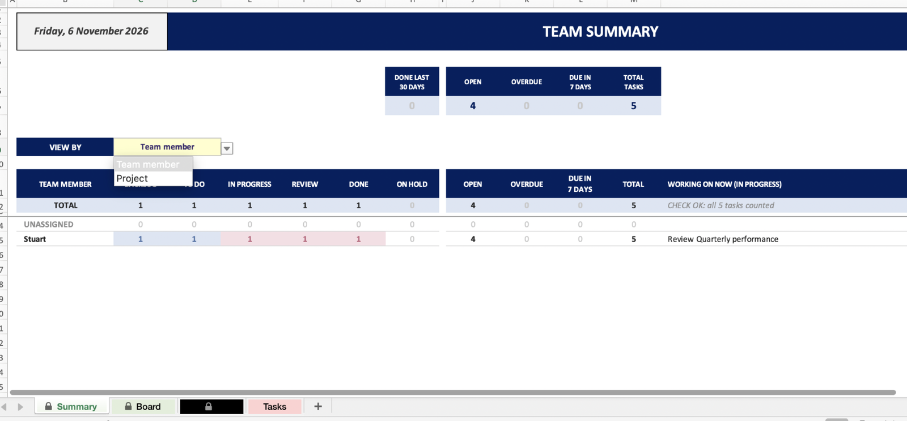
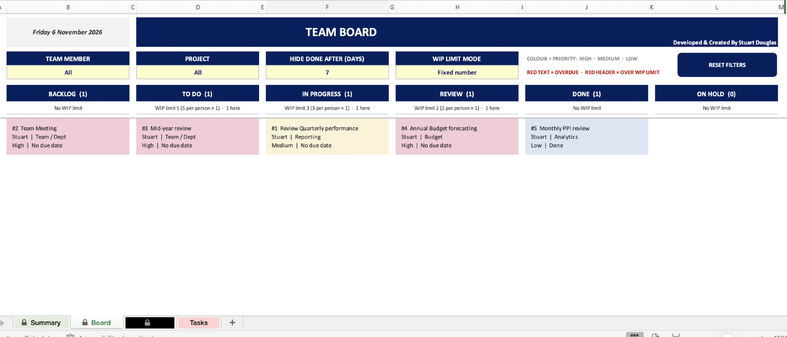
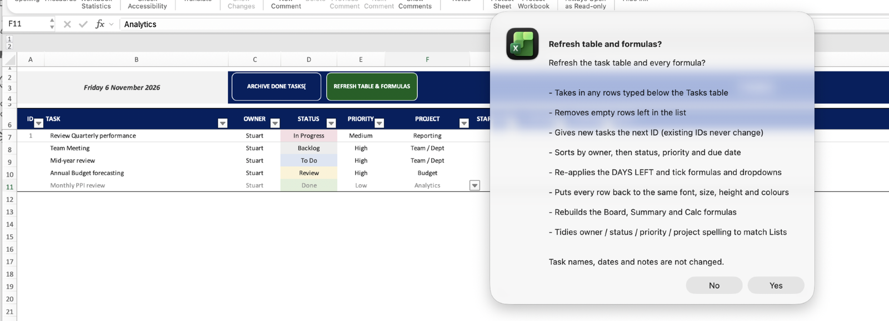

# Team Kanban Tracker

An Excel workbook for tracking what a team is working on. You type tasks into one list. A Kanban board and a team summary build themselves from it.

No add-ins and no lookups to maintain. Change a task's status and its card moves on the board.

---

## Visuals





## Get the workbook

The finished workbook is not committed. Build it yourself in a few seconds:

```
python3 -m venv .venv && .venv/bin/pip install -r requirements.txt
.venv/bin/python build_tracker.py
```

## What's in the workbook

| Sheet | What it does |
|---|---|
| **Summary** | Whole-team view. Pick **VIEW BY**: Team member or Project. Same columns either way: tasks at each stage, open, overdue, due in 7 days, total, and what's being worked on now. The workbook opens here. |
| **Board** | Kanban board: Backlog, To Do, In Progress, Review, Done, On Hold. One card per task showing ID, task, owner, project, priority and due date. **TEAM SELECTION** and **PROJECT** dropdowns filter the cards; **RESET FILTERS** puts both back to All. Empty slots stay blank. |
| **Tasks** | The task list: the only place you type. ☑ ticks show how far each task has got. **ARCHIVE DONE TASKS** asks Yes/No, then moves every Done task to the Archive and closes up the list. |
| **Lists** | Team names (up to 200), projects (up to 50), status names, priorities, WIP limits. |
| **How to use** | Plain-English guide inside the workbook. |
| **Calc** | Formulas behind the board and summary. Nothing to type. |
| **Archive** | Hidden. Archived Done tasks, each run added at the next free row with the date archived and the task's ID at the time. |

**Room to grow.** There are 1,000 task rows, and archiving frees them up again. Every board column has a card slot for every task, so the board never runs out. New names on Lists reach every dropdown and the Summary straight away.

**Reading the board.** Card colour = priority (rose High, cream Medium, blue Low). Red text = overdue. A red column header means the whole team is over that column's WIP (work in progress) limit. Cards sort High priority first, then by soonest due date. Done cards leave the board after 30 days; you can change that on the Board.

**On open**, a macro (`vba/ThisWorkbook.vba`) protects every sheet with no password, sets 110% zoom and lands on Summary. Only the input cells take typing. Without macros the workbook still works, just unprotected. Mac Excel accepts the protection only partly; Windows Excel runs it fully.

---

## Build

The workbook is generated, not hand-edited. To change the layout, edit `build_tracker.py` and rebuild.

```bash
python3 -m venv .venv && source .venv/bin/activate
pip install -r requirements.txt
python3 build_tracker.py
```

The build has three steps:

1. **openpyxl** writes the workbook (formulas, formatting, dropdowns, buttons).
2. **Microsoft Excel** (macOS, via AppleScript) recalculates the file and saves it as Excel binary (`.xlsb`).
3. The macros are copied in from `vba/vba_template.xlsb`. The two buttons are drawing shapes added in step 1, linked to the macros by name.

Step 2 needs Excel for Mac. Steps 1 and 3 are plain Python.

### Changing the macros

`vba/ThisWorkbook.vba` (open-workbook) and `vba/KanbanMacros.bas` (the two buttons) are the readable copies. The build uses the compiled copies inside `vba/vba_template.xlsb`, because Excel only fires `Workbook_Open` reliably for a macro project it compiled itself. To change a macro:

1. Edit the readable copy.
2. Open `vba/vba_template.xlsb` in Excel.
3. In the Visual Basic Editor, paste the code into **ThisWorkbook** or **Module1**, then Debug > Compile.
4. Save, close, and rebuild.

---

## Files

```
build_tracker.py        builds Kanban_Tracker.xlsb
Kanban_Tracker.xlsb     the workbook
vba/ThisWorkbook.vba    open-workbook macro (readable copy)
vba/KanbanMacros.bas    RESET FILTERS and ARCHIVE DONE TASKS macros (readable copy)
vba/vba_template.xlsb   Excel-compiled copies of the macros the build uses
```
